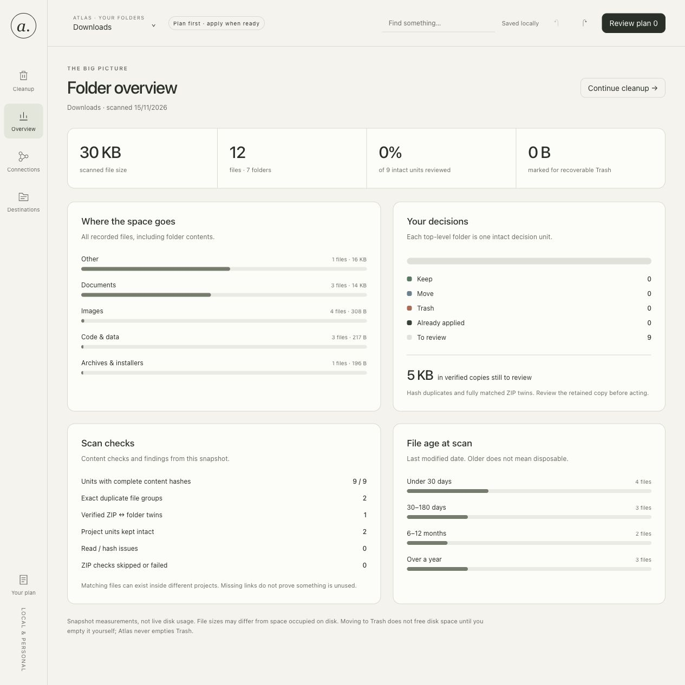
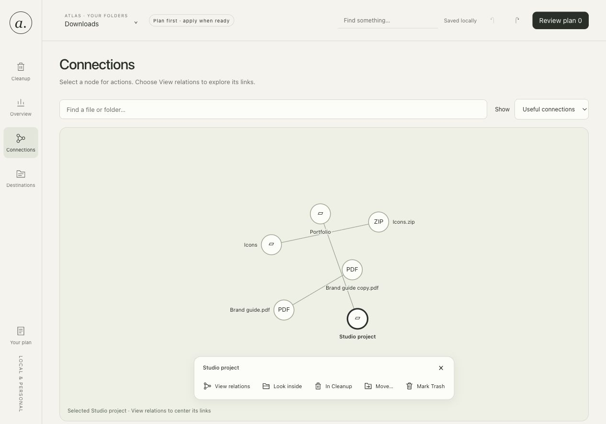
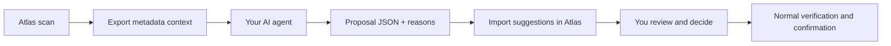

<div align="center">

# Atlas

**See the mess. Make a decision. Get your space back.**

A small, local folder cleanup tool for macOS.<br>
Previews, duplicates, extracted ZIPs and project connections—together in one calm interface.

[Get started](#get-started) · [How it works](#how-it-works) · [Bring your AI agent](#bring-your-ai-agent) · [Contribute](CONTRIBUTING.md)

[](https://github.com/Simon05/Atlas/actions/workflows/checks.yml)
[GitHub](https://github.com/Simon05/Atlas) · [Report a bug](https://github.com/Simon05/Atlas/issues/new/choose) · [Star Atlas](https://github.com/Simon05/Atlas/stargazers)

`Local first` · `Keep / Move / Trash` · `Folders stay intact` · `MIT licensed`

</div>



### A little less digging. A lot more clarity.

Downloads gets messy because deciding takes time. Atlas does the comparisons first,
so you can recognize what you have and choose what belongs.

- **Cleanup** — visual cards, simple filters and one shared Keep / Move / Trash bar.
- **Connections** — a draggable map. Click to select; choose **View relations** to center an item and its links. Matching contents and actual project references stay distinct.
- **Overview** — size by file type, file counts, review progress and scan coverage.
- **Destinations** — choose a home once for your selection. Projects stay together.
- **Your plan** — review, verify and explicitly apply changes; restore from the undo history.

Shift-click a range, ⌘/Ctrl-click to add, or drag across the gaps to box-select.
Double-click a card to look inside. **K / M / T** mark decisions; **⌘Z** undoes a mark.
Switch scanned folders without losing their individual plans.

<details>
<summary>See the Connections map</summary>



</details>

## Get started

Requires **macOS and Python 3.9+**. Clone this repository, open its folder, then run:

```sh
git clone https://github.com/Simon05/Atlas.git
cd Atlas
python3 launch.py
```

Or double-click **Open Atlas.command**. Atlas opens on `http://127.0.0.1:8765`.
Choose a folder and let the read-only scan finish. No account, AI key, Node installation
or paid service is needed to run Atlas.

<details>
<summary>Optional previews and launch options</summary>

For richer image/font previews, install the optional dependency in a virtual environment:

```sh
python3 -m venv .venv
source .venv/bin/activate
python3 -m pip install -r requirements.txt
python3 launch.py
```

Video frame thumbnails also use `ffmpeg` when available on PATH. Atlas still works
without it. To use another local port or keep the browser closed:

```sh
python3 launch.py --port 8766 --no-browser
```

</details>

## How it works

```mermaid
flowchart LR
    A[Choose a folder] --> B[Read-only scan]
    B --> C[Recognize and compare]
    C --> D[Keep · Move · Trash]
    D --> E[Review your plan]
    E --> F[Verify current files]
    F --> G[Explicit confirmation]
    G --> H[Move or recoverable Trash]
    H --> I[Undo journal / restore]
```



The scan compares **SHA-256 hashes**, verifies candidate ZIPs against extracted folder
contents, groups font families, identifies project units, and resolves supported static
project references. Installer matches use installed application **names**, not disk image
contents. Cache and possible leftover findings always need your judgment.

A shared file does not make two folders dependent on one another. A resolved project
reference is stronger evidence; Atlas warns before you mark affected units. Missing
references and old dates never prove a file is disposable.

**Marking is planning. Nothing moves until you verify and confirm.** Atlas never
permanently deletes files or empties Trash. Trash still uses disk space until you empty
it yourself. Within-volume moves also do not free space.

## Bring your AI agent

Atlas works on its own. Your existing AI agent can add context: recognize an old project,
explain uncertain leftovers, or suggest better destinations. There is no built-in model
subscription or automatic upload.

Open an agent session in the cloned Atlas folder and ask:

> Read AGENTS.md and skills/atlas-cleanup/SKILL.md. Refine my Atlas scan into an
> importable proposal. Explain what is verified and what is uncertain. Keep project
> folders intact. Do not move or delete anything.



In Cleanup, open **Refine suggestions with your AI agent**, export context, and import
the proposal when ready. Importing refines suggestions; it does not replace your marks
or perform file operations. Fingerprints and the scan timestamp must match.

The agent instructions live in [AGENTS.md](AGENTS.md) and the
[cleanup skill](skills/atlas-cleanup/SKILL.md). Read the [AI workflow guide](docs/ai-workflow.md)
for metadata export, the proposal format and limits. Agents differ in automatic skill
discovery; naming those files explicitly works across tools.

## Your data stays yours

Atlas serves locally, with no analytics or built-in cloud calls. Scans, private pages and
execution journals stay in ignored **`.atlas/`**. Decisions are saved per source folder
in your browser. Back them up from **Your plan** before switching browsers or addresses;
keep execution journals for restoration.

Exported metadata contains filenames, folder paths and analysis evidence. If you give it
to an external AI agent, that agent's own provider and permissions apply. Atlas cannot
control what a separate agent reads or transmits.

### Current limits

- Scans are snapshots; reopening a saved folder does not silently rescan it.
- Projects outside the scan, dynamic references and unsupported formats can be missed.
- All top-level folders remain intact decision units. Scan a project's parent to organize the entire project.
- Moves currently require the same volume and a dedicated destination under common personal folders. Restore refuses changed files and occupied original paths.
- macOS is the execution target. Windows/Linux file operations are not validated.

## Contributing

Keep Atlas small: faster recognition, clearer evidence, easier decisions.
See [CONTRIBUTING.md](CONTRIBUTING.md) for the source map and test commands.
All test data and public screenshots are synthetic; no personal scans belong in the repo.

If Atlas helps you, a star helps others find it. Bug reports and focused improvements
are welcome. For security issues, see [SECURITY.md](SECURITY.md).

## Star history

[](https://star-history.com/#Simon05/Atlas&Date)

[MIT License](LICENSE)
